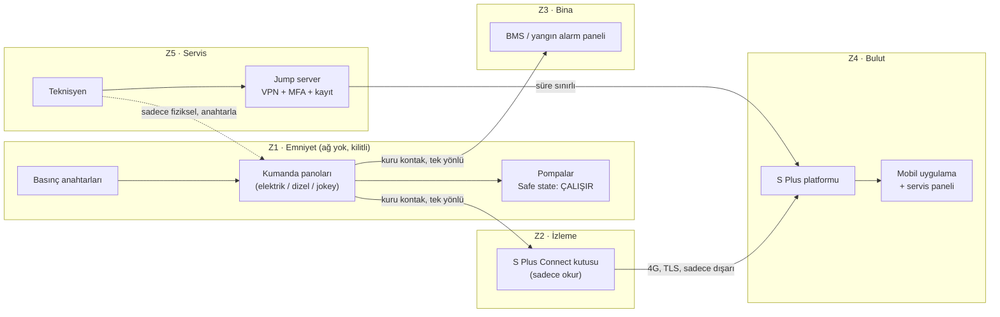

# S Plus Connect — Mimari

**Ana ilke:** Veri sadece emniyet bölgesinden dışarı akar. Hiçbir ağ bağlantısı pompayı başlatamaz, durduramaz ya da ayarını değiştiremez.

## Bileşenler ve sınırlar

| Bileşen | Yapar | Yapamaz |
| --- | --- | --- |
| Kumanda panoları | Pompayı otomatik/elle çalıştırır, alarmları üretir | Ağdan komut almaz |
| S Plus Connect kutusu | Kuru kontakları okur, olay ve test kaydını buluta yollar, bağlantı kesilince alarm üretir | Panoya sinyal yazamaz (fiziksel olarak çıkış yok) |
| BMS | Durumu gösterir | Pompayı çalıştıramaz / durduramaz (katalog önerisi) |
| Bulut | Bildirim, rapor, arıza tahmini | Kutuya komut göndermez; sadece imzalı güncelleme |
| Jump server | Kayıtlı, süre sınırlı servis erişimi | Kalıcı açık değildir |

## Güvenlik özellikleri (CRA ve IEC 62443 ile eşleşme)

| Özellik | Karşıladığı gereksinim |
| --- | --- |
| Varsayılan parola yok, cihaza özel sertifika | Güvenli varsayılan yapılandırma |
| Sadece dışarı giden TLS, gelen port kapalı | Saldırı yüzeyini küçültme |
| İmzalı güncelleme, SBOM | Güvenlik güncellemeleri ve açık yönetimi |
| Olay ve oturum kaydı | Kayıt ve izleme, olay müdahalesi |
| "Kutu sustu" alarmı | Erişilebilirlik / kesintinin fark edilmesi |
| Tek yönlü kablolama | Emniyet fonksiyonunun bağımsızlığı (Lab 4) |
